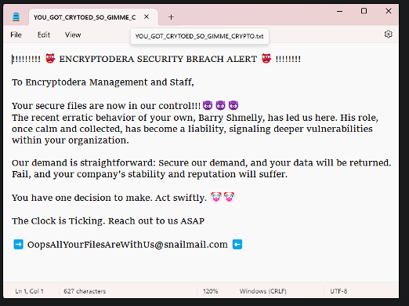

# KC7 Inside Encryptodera: An Insider Threat Scenario

## About This Investigation

Encryptodera is a financial services company specializing in cryptocurrency, blockchain, payment gateways, and digital wallets. Rumors of layoffs caused significant tension among employees, but the situation escalated into a much larger cyber incident involving:

- A disgruntled insider
- Ransomware deployment across the network
- A phishing and lateral-movement chain
- A second insider attempting to exfiltrate cryptocurrency data


## Welcome to Encryptodera

After confidential documents were leaked to the media, Encryptodera hired an incident responder to investigate the activity. This README documents the investigation findings and the supporting screenshots captured while reviewing the logs.

---

# Investigation 1: Environment and Employee Baseline

### How many employees work at Encryptodera?

**Answer: 600**


### Which employee owns IP `10.10.0.216`?

**Answer: Nakia Acosta**


Nakia Acosta's details:

- **Email:** nakia_acosta@encryptoderafinancial.com
- **Role:** IT Helpdesk Technician
- **Username:** naacosta
- **Hostname:** P224-LAPTOP

She received **38 emails**.


### Distinct senders from `bitbingersbanking.net`

**Answer: 1204**


### Distinct websites visited by Timothy Geffre

**Answer: 92**


### Passive DNS results containing "money"

**Domains found:** 15

**`moneyppl.com` resolved to:** `211.152.115.93`


### Employees named Karen

- **Distinct URLs visited:** 321
- **Authentication attempts:** 420


---

# Investigation 2: Barry Shmelly — Disgruntled Employee

## Employee Profile

- **Name:** Barry Shmelly
- **Role:** StackOverflow Copy Paster
- **Email:** barry_shmelly@encryptoderafinancial.com
- **IP:** `10.10.0.1`
- **Hostname:** IGOY-DESKTOP
- **Username:** bashmelly


## Barry's Email Activity

Barry sent a January 16 email with the subject:

> I'm not coming in today. I'm sick of this place. We're all getting laid off anyway.


The recipients of Barry's January 16 email were **Social Media Managers**.

Barry also sent an email on January 18 with the subject:

> YOU ARE A GREEDY PIG!!!! WHAT IS WRONG WITH YOU?????

The recipient was the **Chief Executive Officer**.


## Suspicious Web Activity

On December 26, Barry browsed:

**https://www.cybersecurity-insiders.com/safe-ways-to-transfer-sensitive-files**


Barry's first recorded download-related search on January 15 was:

**https://www.7-zip.org/a/7z2002-x64.exe**


He also searched for instructions on USB flash drives:

**https://www.wikihow.com/Use-a-USB-Flash-Drive**


## Confidential Downloads

| Item | Filename |
|---|---|
| Mergers and acquisitions strategy | `SECRET_MergersAndAcquisitions_Strategy2025.docx` |
| Executive salaries | `ExecutiveSalaryNegotiations.docx` |
| Proprietary algorithms | `Encryptodera_Proprietary_Algorithms.zip` |
| Archive password | `securepass123` |
| Flash drive | `SchmellyDrive` |


These downloads, anomalous behavior, and unusual login times indicated an insider-threat pattern.

---

# Investigation 3: Ransomware Incident

## Ransom Note

The ransom note was named:

**`YOU_GOT_CRYTOED_SO_GIMME_CRYPTO.txt`**




The incident was **ransomware**, and the note appeared on **306 distinct machines**.

The first victim was:

- **Hostname:** UL8R-MACHINE
- **First seen:** `2024-02-17 02:34:54`


## UL8R-MACHINE Analysis

- **Encrypted files:** 50
- **Encryption extension:** `.umadbro`
- **Malicious executable:** `files_go_byebye.exe`
- **Executable creation:** `2024-02-17T02:30:50Z`
- **Commands observed in the investigation window:** 23

The encryption command was:

```text
start /b C:\ProgramData\files_go_byebye.exe -encrypt -target C:\Users\ -ext .umadbro
```


The executable appeared before the ransom note:


## Encoded PowerShell

An encoded PowerShell command referenced:

**`notification-finance-services.com`**

Immediately before the encoded PowerShell command, the attacker ran:

```text
gpupdate /force
```


The `gpupdate /force` command ran on **306 hosts**.

## Discovery and Initial Access

- Machines that ran `systeminfo`: **8**
- First `systeminfo` timestamp: `2024-02-02 03:32:36`
- Elapsed time before ransomware: **15 days**
- First host: **41QI-LAPTOP**


The threat actor identified the domain with:

```text
cmd.exe /C nltest /dclist:encryptoderafinancial.com
```


## Double-Extension and Remote Access Delivery

The malicious file on 41QI-LAPTOP was:

**`Company_Financials_Q1_2024_Review.xlsx.exe`**

The file appearing shortly afterward was:

**`screenconnect_client.exe`**

ScreenConnect appeared on **3 devices**.


The compromised address used to send the malicious link was Barry's account:

**barry_shmelly@encryptoderafinancial.com**


## Barry Account Compromise

Starting February 1, Barry's account sent **9 unusual emails**.

The external IP that signed into Barry's account was:

**`143.38.175.105`**

It was not used to log into any other account.


The IP `10.10.0.138` logged into all discovery hosts and was assigned to a **System Administrator**.

- Successful logins from `10.10.0.138`: **554**
- Server later accessed: **DOMAIN_CONTROLLER_SERVER**
- Domain-admin username: `lihenry_domain_admin`


## Credential Theft on GJ95-LAPTOP

The `lihenry_domain_admin` account signed into:

**GJ95-LAPTOP**


The machine belonged to **Valerie Orozco**. The attacker ran:

```text
totally_not_mimikatz.exe "sekurlsa::logonpasswords"
```

The MITRE ATT&CK tool identifier was:

**S0002**

Valerie was included in the phishing campaign, and the attached filename was:

**`Employee_Contact_List_Updated_March_2024.docx.exe`**

No evidence showed that Valerie clicked the link.


### User accounts on GJ95-LAPTOP

The machine had three distinct accounts:

- `vaorozco`
- `lihenry_domain_admin`
- `systadmi_local_admin`

The `systadmi_local_admin` account attempted to log into **10 hosts**.


The non-IT employee improperly using local-admin credentials was:

**Robin Kirby**

Robin was phished at:

**2024-02-01T03:59:30Z**


## Ransomware Attack Chain

1. Barry's account was compromised externally.
2. Nine phishing emails were sent to employees.
3. Robin Kirby was compromised.
4. Stolen local-admin credentials moved laterally to GJ95-LAPTOP.
5. Mimikatz dumped domain-admin credentials.
6. The attacker logged into the domain controller.
7. A malicious GPO deployed ransomware to 306 machines.

---

# Investigation 4: Jane Smith — Data Exfiltration

## Jane's Profile

- **Name:** Jane Smith
- **Role:** Cryto Bruh (Blockchain Contractor)
- **IP:** `10.10.0.2`
- **Hostname:** GOTI-LAPTOP
- **Username:** jasmith

## Suspicious Network Transfer

The largest amount of data sent on February 5 went to:

**`182.56.23.121`**


The first transfer occurred at:

**2024-01-21T13:28:33Z**

The destination had been contacted for:

- **Distinct days:** 27
- **Distinct employees:** 1
- **Service:** FTP
- **Total bytes transferred:** 208138


## Jane's Suspicious Browsing

Jane browsed Encryptodera's internal documentation and searched for:

**"cold storage crypto wallets"**


## Jane's Suspicious Email Conversation

The external conversation partner was:

**elboss@westealurcrypto.com**

The boss provided Jane with the smuggling destination:

**`182.56.23.121`**


## Exfiltration Tools

- **FTP exfiltration tool:** `ftp_client.exe`
- **Cryptocurrency theft tool:** `crypto_stealer.exe`


Jane staged data in:

```text
C:\Users\jasmith\ToTheMoon\
```

The tool was scheduled to run:

**daily**

Its password was:

**Ugot2muchCRYTOw3llt4k3it0FFurH4ND5**


---

## Investigation Conclusion

The Encryptodera investigation uncovered two separate insider-threat events that became connected to a broader intrusion:

1. **Barry Shmelly** downloaded sensitive files and later had his account compromised for phishing activity.
2. **The threat actor** moved laterally, stole domain credentials, deployed ransomware, and affected 306 systems.
3. **Jane Smith** exfiltrated data to an external IP using FTP and cryptocurrency theft tools.

The evidence in this repository demonstrates how multiple log sources can be correlated to identify employee abuse, phishing, credential theft, lateral movement, ransomware deployment, and data exfiltration.
